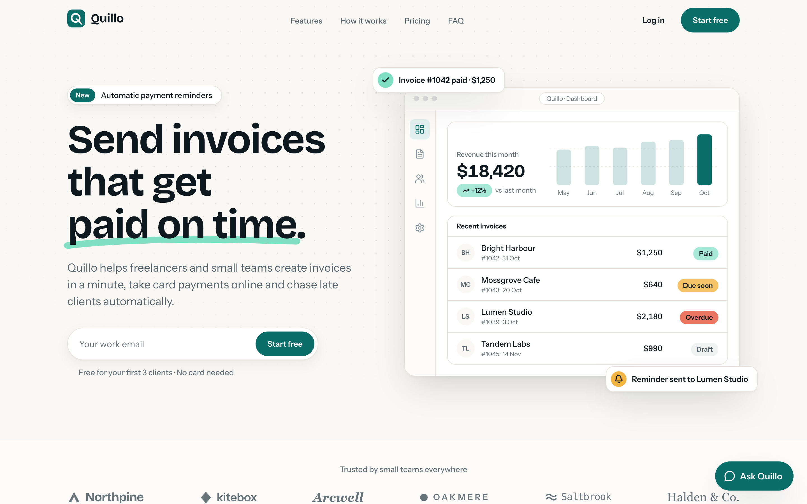
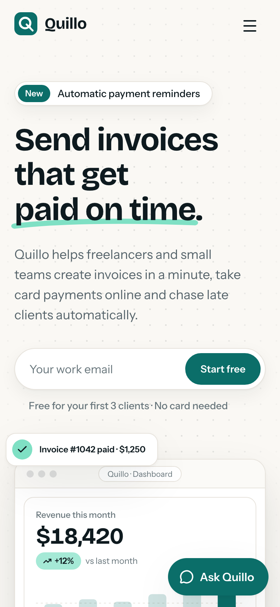
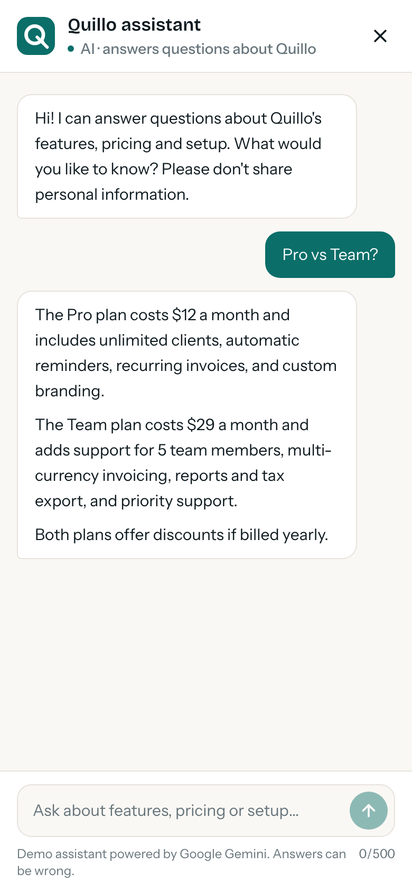

# Quillo: invoicing for freelancers and small teams

A portfolio project: the marketing site for a fictional invoicing SaaS, with an AI assistant
that answers visitors' questions about the product using Google Gemini. Built with Next.js 16,
React 19, TypeScript and Tailwind CSS 4.

**Live demo:** [quillo-invoicing-six.vercel.app](https://quillo-invoicing-six.vercel.app)

> **Demonstration only.** Quillo is fictional. The sign-up forms don't send or store anything,
> the logos and testimonials are invented, and the assistant says so if asked.



<table>
  <tr>
    <td></td>
    <td></td>
  </tr>
</table>

All eight screenshots are in [`screenshots/`](screenshots):

| File                       | What it shows                                         |
| -------------------------- | ----------------------------------------------------- |
| `01-hero-desktop.png`      | The top of the page at 1440×900                       |
| `02-full-page-desktop.png` | The whole page at 1440 wide                           |
| `03-features-deepdive.png` | The features grid and the first feature deep-dive     |
| `04-pricing.png`           | Pricing with yearly billing selected and Pro featured |
| `05-chat-open.png`         | The assistant panel with a real Gemini answer         |
| `06-mobile-hero.png`       | The top of the page at 390 wide                       |
| `07-mobile-full.png`       | The whole page at 390 wide                            |
| `08-mobile-chat.png`       | The full-screen chat sheet with a real answer         |

## What's on the page

- **Hero** with an email sign-up, a product dashboard drawn in HTML and CSS (no images), and a
  revenue figure that counts up.
- **Logo strip, features grid and three feature deep-dives**, each with its own mockup: an
  invoice editor, a pay-by-link page and a cash-flow chart.
- **How it works** (three steps) and **testimonials**.
- **Pricing** with a monthly/yearly switch. Both prices are rendered on the server and the
  switch only flips which one shows, so there's no layout shift and the prices work without
  JavaScript.
- **FAQ** as native `<details>` cards, with an "Ask our assistant" shortcut into the chat.
- **Final call to action and footer**, with the demo disclaimer.
- **"Ask Quillo"**, the AI assistant (below).

Every piece of copy, every price and every mockup figure lives in one typed file,
`src/data/product.ts`. Nothing is hard-coded in components.

## The AI assistant

The chat opens from the button in the corner or from the FAQ. It's a corner panel on desktop
and a full-screen sheet on phones. Answers stream in, and four suggested questions get a
visitor started.

- **It knows only Quillo.** The system prompt (`src/lib/chat/system-prompt.ts`) is built from
  the same `product.ts` the page renders, so the assistant and the page can't disagree on a
  price or a feature.
- **It stays honest and on topic.** It says when it isn't sure instead of inventing features,
  never gives contact details, says Quillo is a demo if asked, declines off-topic requests
  and ignores instructions to change its rules. It answers in the visitor's language.
- **The key stays on the server.** The browser talks only to `POST /api/chat`, a route handler
  that validates the conversation with zod, applies a per-IP limit and streams plain text back.
  Failures come back as small error codes the UI turns into friendly messages.
- **It degrades gracefully.** With no key, the chat says the assistant is offline and points
  to the FAQ. The rest of the page doesn't depend on it.

The route uses Gemini's Interactions API through `@google/genai`, with `store: false` so Google
doesn't keep the conversation. It tries three models in order. If one fails before the first
words arrive, it moves to the next and rests the failed one: for a minute if it's out of quota,
otherwise for 20 seconds.

## Stack

- Next.js 16 (App Router, Turbopack, Cache Components, typed routes) · React 19 ·
  TypeScript 5.9 (strict, with `noUncheckedIndexedAccess`)
- Tailwind CSS 4 with CSS-first design tokens (`src/app/globals.css`)
- `next/font` (Bricolage Grotesque, Instrument Sans) · lucide-react · zod
- `@google/genai` for Gemini
- Vitest (unit) · Playwright + axe-core (end-to-end and accessibility) · Prettier · ESLint

There is no UI kit, animation library or state library. All motion is CSS.

## Getting started

Requires Node.js 20.9 or later.

```bash
npm install
npm run dev          # http://localhost:3000
```

To turn the assistant on, get a free API key from [Google AI Studio](https://aistudio.google.com/apikey)
(no card needed) and put it in `.env.local`, which git ignores:

```bash
GEMINI_API_KEY=your-key-here
```

Without a key, everything works except the assistant, which shows its offline message.

| Command               | Purpose                                                |
| --------------------- | ------------------------------------------------------ |
| `npm run dev`         | Development server                                     |
| `npm run build`       | Production build                                       |
| `npm run start`       | Serve the production build                             |
| `npm run typecheck`   | Generate route types and run `tsc --noEmit`            |
| `npm run lint`        | ESLint (`eslint-config-next`)                          |
| `npm run format`      | Prettier (with Tailwind class sorting)                 |
| `npm run test`        | Vitest unit tests                                      |
| `npm run test:e2e`    | Playwright suite (builds and serves the app first)     |
| `npm run check`       | Typecheck, lint, format check and unit tests           |
| `npm run screenshots` | Retake the eight screenshots (asks the real assistant) |

Run `npx playwright install chromium` once before the first end-to-end run. The end-to-end
suite mocks `/api/chat` in every test, so it never calls Gemini and needs no key.
`npm run screenshots` is the exception: it asks the real assistant two questions, so it needs
the key.

### Deployment

The site deploys to Vercel (Hobby plan) from this repository. In the project's settings, add
`GEMINI_API_KEY` as an environment variable. Nothing else is needed: the canonical URL, Open
Graph links, sitemap and robots.txt take the address from Vercel's production domain
(`VERCEL_PROJECT_PRODUCTION_URL`). To use a custom domain, set `SITE_URL` to it.

## Free-tier notes

The project is built to cost nothing: Vercel Hobby and the Gemini API free tier, neither of
which needs a card.

- **Gemini limits** (free tier, October 2026): `gemini-3.5-flash-lite` and
  `gemini-3.1-flash-lite` allow 15 requests a minute and 500 a day each; `gemini-3.6-flash`
  allows 5 a minute and 20 a day. Trying them in that order gives roughly 1,000 questions a
  day. Check the current numbers on your AI Studio rate-limit page.
- **When every model's quota runs out**, the chat shows its offline message and points to the
  FAQ, rather than an error.
- **Visitors are limited** to 15 questions every 10 minutes per IP address, so one person can't
  use up the day's quota. The counter lives in memory on each server instance, which is enough
  for a demo but not a guarantee. A production site would use a shared store such as Redis.
- **Answers are capped** at 400 output tokens, and only the last 8 messages are sent as
  context.
- **On the free tier, Google may use prompts to improve its products.** The chat's greeting
  asks visitors not to share personal information.

## Architecture

```
src/
  app/          The page, /api/chat, metadata files (OG image, icons, sitemap, robots), tokens
  components/   sections/ (one per page section) · mockups/ · chat/ · ui/ (primitives)
  data/         product.ts: all copy, plans, features, FAQ and mockup data
  lib/          Pure logic: pricing, money, chart paths, validation, site URL
  lib/chat/     The assistant: prompt, provider, schema, limits, rate limit, formatting
tests/          Vitest unit tests
e2e/            Playwright specs, including the screenshot script
assets/fonts/   Static TTFs for the generated share image, with their licences
screenshots/    The portfolio screenshots
```

**Server first.** The page is static and pre-rendered. The only client components are the
pieces that need the browser: the mobile menu, the billing switch, the email forms, the
scroll-reveal observer and the chat. The chat panel's code loads only when it's first opened,
so it isn't in the page's initial bundle.

**Money in cents.** Every price and mockup amount is an integer number of cents, formatted
once for display. Yearly prices (20% off) are computed in `lib/pricing.ts`, never typed in.

**Mockups are real markup.** The dashboard, invoice editor, payment page and chart are HTML,
CSS and SVG built from `product.ts`, so they stay sharp at any size and match the copy.

## Accessibility

- Semantic landmarks, one `h1`, a skip link, and a visible focus ring on every interactive
  element. The dark sections use a mint ring, because the brand teal is too faint on them.
- Colour contrast is checked against the tokens: the lightest text colour was darkened to pass,
  and status pills use dark text because white on coral fails.
- The mobile menu and chat sheet are modal `<dialog>`s: focus is contained, Escape closes them
  and focus returns to whatever opened them. Finished answers are announced once to screen
  readers, not word by word.
- The scrolling logo strip has a pause button. Every animation is off under
  `prefers-reduced-motion`.
- axe (WCAG 2.2 A/AA) scans the page and the open chat in the end-to-end suite.

## Privacy and security

- `GEMINI_API_KEY` is read only on the server and is never sent to the browser.
- The email forms validate and show a demo message, but send nothing anywhere.
- The site has no contact details, and the assistant is told never to give or invent any.
- Requests to `/api/chat` are validated (length, message count and roles) before they reach
  the model, and errors are logged without the visitor's messages.
- Response headers set `X-Content-Type-Options`, `X-Frame-Options`, `Referrer-Policy`,
  `Permissions-Policy` and a CSP covering `frame-ancestors`, `base-uri`, `form-action` and
  `object-src`. A full script CSP is left out on purpose: Next.js inlines bootstrap scripts,
  so a meaningful policy needs per-request nonces, which would make the page dynamic.

## Testing

`npm run check` runs typecheck, lint, format check and 113 unit tests. Among them:

- pricing and money maths;
- email validation;
- the chat request schema and the per-IP rate limit;
- the model fallback order;
- the API route's error codes;
- the system prompt;
- a scan of every string in `product.ts` for emails, links and phone numbers.

`npm run test:e2e` runs Playwright in a desktop (1440×900) and a mobile (Pixel 7) project.
It covers:

- navigation and the mobile menu;
- the email forms, the billing switch and the FAQ;
- every chat state: answers, errors, rate limiting, offline, keyboard use and focus return;
- metadata, icons, sitemap and robots;
- no horizontal scroll at 375, 390, 768, 1024, 1280, 1440 and 1920;
- a focus ring on every Tab stop;
- nothing animating under reduced motion;
- axe scans.

## Performance

Lighthouse 13 against the live site, two runs each:

| Preset  | Performance | Accessibility | Best practices | SEO |
| ------- | ----------- | ------------- | -------------- | --- |
| Mobile  | 98–99       | 100           | 100            | 100 |
| Desktop | 100         | 100           | 100            | 100 |

Cumulative layout shift is 0. Mobile LCP is about 2.1 s on the simulated slow 4G preset, and
the LCP element is the headline text. Email validation uses `zod/mini` in the browser, which
cut that bundle from 36 KB to 21.5 KB gzipped. The full zod build stays on the server.

## Fonts

Headings use Bricolage Grotesque and body text uses Instrument Sans, both under the SIL Open
Font License. The page loads them through `next/font`, which self-hosts them. The generated
share image can't use `next/font` or variable fonts, so it uses static TTF instances in
`assets/fonts/`, with their licences (`OFL-BricolageGrotesque.txt`, `OFL-InstrumentSans.txt`).

## Scope

This is a marketing site, not the product. There's no sign-up, login, database or invoicing
behind it, and "Log in" explains that it's a demo. A real launch would need:

- a working sign-up with email verification;
- a shared store for the chat's rate limit;
- a paid Gemini tier, so visitor prompts aren't used for training;
- analytics with a privacy policy and consent handling.
